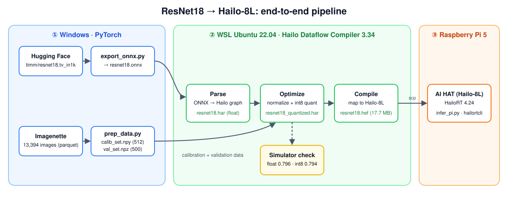
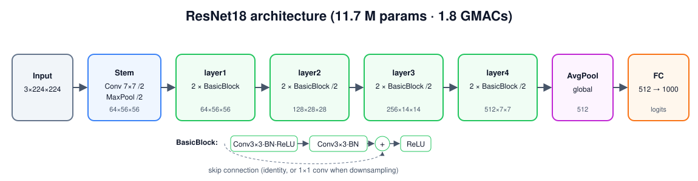
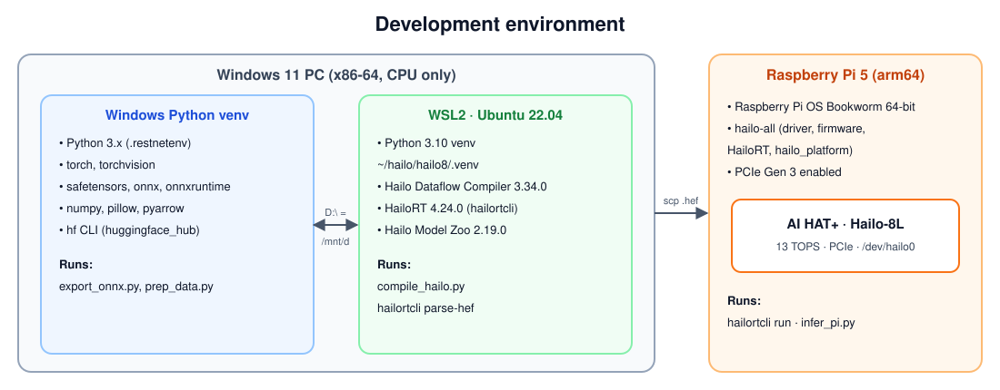
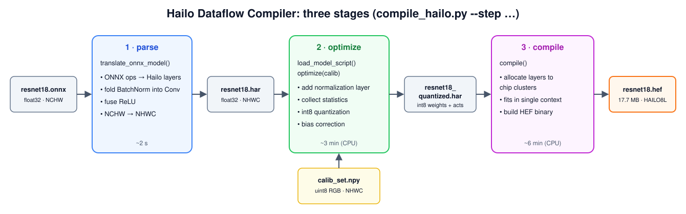
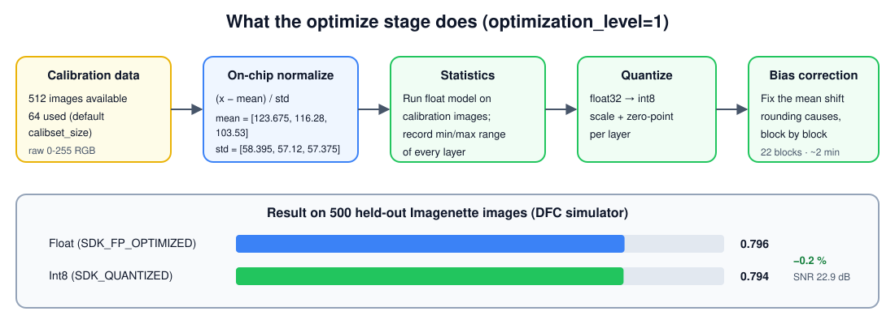
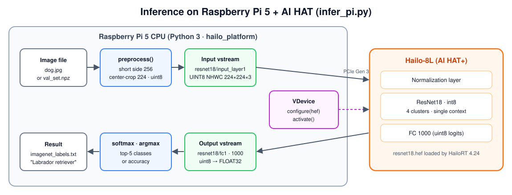
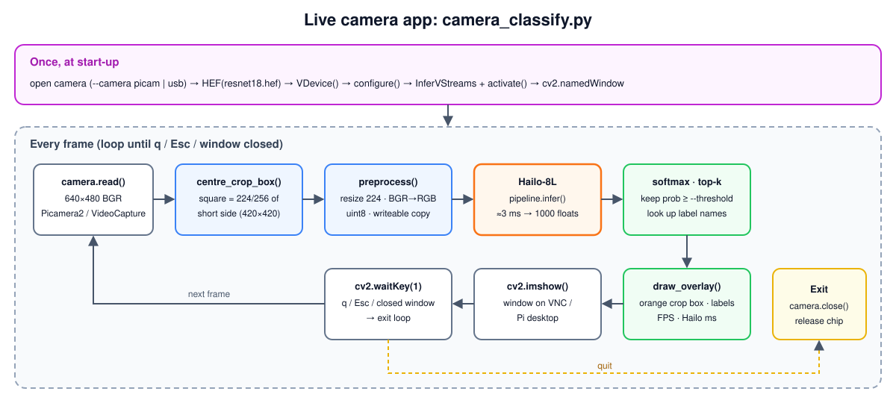

# ResNet18 on Hailo-8L (Raspberry Pi 5 AI HAT+)

A complete, reproducible walkthrough: take a pretrained **ResNet18** from Hugging Face, convert it to ONNX, quantize and compile it with the **Hailo Dataflow Compiler (DFC)**, and run it on a **Raspberry Pi 5 with the Hailo-8L AI HAT+**.



| Result | Value |
|---|---|
| Model | `timm/resnet18.tv_in1k` (original torchvision ImageNet weights) |
| Target | Hailo-8L, compiled with DFC 3.34.0 / HailoRT 4.24.0 |
| Float accuracy (DFC simulator) | **0.796** top-1 on 500 Imagenette images |
| Int8 accuracy (DFC simulator) | **0.794** top-1 (−0.2 %) |
| Output-layer SNR | 22.93 dB |
| HEF | 17.7 MB, single context, 4 of 8 clusters |
| Hailo-8L throughput (`hailortcli run`) | **914.8 FPS** |
| Hailo-8L hardware latency | **2.77 ms** |
| On-device accuracy (`infer_pi.py --val`) | **0.796** top-1 (751 img/s including Python overhead) |

---

## Contents

1. [Concepts](#1-concepts)
2. [Environment](#2-environment)
3. [Project layout](#3-project-layout)
4. [Step 1 — Download the model](#4-step-1--download-the-model)
5. [Step 2 — Export to ONNX](#5-step-2--export-to-onnx)
6. [Step 3 — Calibration & validation data](#6-step-3--calibration--validation-data)
7. [Step 4 — Parse, optimize, compile with the DFC](#7-step-4--parse-optimize-compile-with-the-dfc)
8. [Run on Raspberry Pi 5 + AI HAT](#8-run-on-raspberry-pi-5--ai-hat)
9. [Accuracy analysis](#9-accuracy-analysis)
10. [Optimization knobs](#10-optimization-knobs)
11. [Troubleshooting](#11-troubleshooting)
12. [Quick-start checklist for a new user](#12-quick-start-checklist-for-a-new-user)
13. [Next steps](#13-next-steps)
14. [Credits & licenses](#14-credits--licenses)

---

## 1. Concepts

| Term | What it means here |
|---|---|
| **ResNet18** | An 18-layer convolutional classifier (11.7 M parameters, 1.8 GMACs). Trained on ImageNet-1k, it outputs 1000 class scores. |
| **ONNX** | A framework-neutral model file. PyTorch writes it; the Hailo DFC reads it. |
| **HAR** | *Hailo Archive*: the DFC's internal model format. Produced by each DFC stage. |
| **Quantization** | Converting 32-bit float weights/activations to 8-bit integers. The Hailo chip computes in int8, which is far faster and lower-power. |
| **Calibration set** | Real sample images the DFC runs through the model to measure each layer's value range before choosing int8 scales. |
| **HEF** | *Hailo Executable Format*: the compiled binary that runs on the chip. The only file the Pi needs. |
| **HailoRT** | The runtime library + driver on the device that loads a HEF and runs inference. |
| **VDevice** | HailoRT's "virtual device" object: your program's handle to one or more physical Hailo chips. |

### ResNet18 architecture



Every layer is a plain convolution, BatchNorm, ReLU, or add, which is exactly what int8 accelerators handle best. That is why ResNet18 quantizes with almost no accuracy loss (§9).

---

## 2. Environment



| Machine | Software | Used for |
|---|---|---|
| **Windows 11 PC** (x86-64, no GPU needed) | Python 3.x venv with `torch`, `torchvision`, `safetensors`, `onnx`, `onnxruntime`, `numpy`, `pillow`, `pyarrow`; `hf` CLI | Download, ONNX export, data preparation |
| **WSL2 Ubuntu 22.04** (same PC) | Python 3.10 venv with **Hailo DFC 3.34.0**, HailoRT 4.24.0, Hailo Model Zoo 2.19.0 | Parse → optimize → compile |
| **Raspberry Pi 5** + **AI HAT+ (Hailo-8L, 13 TOPS)** | Raspberry Pi OS Bookworm 64-bit, `hailo-all` (driver, firmware, HailoRT, `hailo_platform`) | Benchmark and inference |

> The DFC runs only on x86-64 Linux, which is why it lives in WSL. Windows drives are visible inside WSL at `/mnt/<letter>`, so `D:\…\resnet18` is `/mnt/d/…/resnet18`, and both sides share the same files.

### 2.1 Windows setup

```powershell
python -m venv .restnetenv
.\.restnetenv\Scripts\activate
pip install torch torchvision safetensors onnx onnxruntime numpy pillow pyarrow
# Hugging Face CLI (provides the `hf` command)
pip install -U "huggingface_hub[cli]"
```

### 2.2 WSL + Hailo DFC setup

Download from the [Hailo Developer Zone](https://hailo.ai/developer-zone/) (free account):
`hailo_dataflow_compiler-3.34.0-py3-none-linux_x86_64.whl` (and optionally `hailort-4.24.0-cp310-cp310-linux_x86_64.whl` + `hailort_4.24.0_amd64.deb` for `hailortcli`).

```bash
# inside WSL Ubuntu 22.04
sudo apt update
sudo apt install -y python3.10-venv python3.10-dev graphviz libgraphviz-dev
python3.10 -m venv ~/hailo/hailo8/.venv
source ~/hailo/hailo8/.venv/bin/activate
pip install --upgrade pip
pip install ~/hailo/hailo8/hailo_dataflow_compiler-3.34.0-py3-none-linux_x86_64.whl
# optional, for `hailortcli parse-hef` on the PC:
pip install ~/hailo/hailo8/hailort-4.24.0-cp310-cp310-linux_x86_64.whl
sudo dpkg -i ~/hailo/hailo8/hailort_4.24.0_amd64.deb

hailo --version     # expect: Hailo Dataflow Compiler v3.34.0
```

> Give WSL enough RAM. The optimize stage peaked well under the 15 GB this machine had; 8 GB+ is a sensible minimum for ResNet18.

---

## 3. Project layout

```
resnet18/
├── script/
│   ├── export_onnx.py        # Step 2: safetensors → ONNX (+ PyTorch/ONNX equivalence check)
│   ├── prep_data.py          # Step 3: Imagenette parquet → calib_set.npy, val_set.npz
│   ├── compile_hailo.py      # Step 4: ONNX → HAR → quantized HAR → HEF (+ simulator accuracy)
│   ├── infer_pi.py           # §8.5:   runs the HEF on the Pi (single image or accuracy)
│   └── camera_classify.py    # §8.6:   live camera → Hailo-8L → OpenCV window
├── docs/
│   ├── README.md             # this document
│   └── images/               # block diagrams (SVG + PNG)
├── timm-resnet18.tv_in1k.safetensors   # Step 1 (not committed, 47 MB)
├── train-00000-of-00001.parquet        # Step 3 input (not committed, 348 MB)
└── hf_out/                             # generated artifacts (not committed)
    ├── resnet18.onnx               47 MB
    ├── calib_set.npy               77 MB
    ├── val_set.npz                 75 MB
    ├── resnet18.har                47 MB
    ├── resnet18_quantized.har     209 MB
    └── resnet18.hef                18 MB
```

---

## 4. Step 1 — Download the model

**Where:** Windows PowerShell, project root.

```powershell
cd D:\resnet18
$env:HF_HUB_DISABLE_XET = '1'
hf download timm/resnet18.tv_in1k model.safetensors config.json --local-dir hf_models\resnet18.tv_in1k
```

In this study the file was then saved as `timm-resnet18.tv_in1k.safetensors` in the project root; the commands below use that name.

**Why `HF_HUB_DISABLE_XET=1`?** Hugging Face's newer "Xet" download path (`cdn.hf.co`) returned **HTTP 403 Forbidden** on the corporate network used for this study. Disabling it falls back to the classic download. You need it in every new shell; on an unrestricted network you can skip it.

**Why this checkpoint?** `resnet18.tv_in1k` is the original torchvision ImageNet weight file republished by timm. It uses torchvision's exact layer names, so it loads into `torchvision.models.resnet18()` with no conversion and no `timm` dependency.

`config.json` records the preprocessing the model expects. These numbers come back in Step 4:

```json
"input_size": [3, 224, 224],
"interpolation": "bilinear",
"crop_pct": 0.875,
"mean": [0.485, 0.456, 0.406],
"std":  [0.229, 0.224, 0.225]
```

---

## 5. Step 2 — Export to ONNX

**Where:** Windows.

```powershell
python script\export_onnx.py --weights timm-resnet18.tv_in1k.safetensors --out hf_out
```

**Expected output**

```
loaded weights: 11.689512 M params
wrote hf_out\resnet18.onnx  max |pytorch - onnx| = 2.62e-06
```

(A `DeprecationWarning` about the legacy TorchScript exporter is harmless.)

### How the code works — `script/export_onnx.py`

```python
model = resnet18()
missing, unexpected = model.load_state_dict(load_file(args.weights), strict=False)
assert not missing and not unexpected, f"missing={missing} unexpected={unexpected}"
```
Builds an empty torchvision ResNet18 and loads the safetensors weights. `strict=False` plus the assert gives a readable error listing any mismatched layer names instead of a stack trace.

```python
torch.onnx.export(model, dummy, onnx_path, input_names=["input"], output_names=["logits"],
                  opset_version=13, dynamo=False)
```
- **Fixed shape `1×3×224×224`.** Hailo needs static shapes.
- **Named ends `input` / `logits`.** Step 4 refers to these names as the parser's start and end nodes.
- **opset 13, legacy exporter.** A conservative, well-supported combination for the Hailo parser.
- **No normalization inside the model.** The ONNX expects already-normalized input; normalization is added later as a layer *on the Hailo chip*, so the device can be fed raw camera pixels.

```python
ref = model(dummy).numpy()
got = ort.InferenceSession(str(onnx_path)).run(None, {"input": dummy.numpy()})[0]
print(f"... max |pytorch - onnx| = {np.abs(ref - got).max():.2e}")
```
An equivalence check: the same random input through PyTorch and ONNX Runtime. A difference around `1e-5` or smaller means the export is faithful.

**Optional:** open `hf_out/resnet18.onnx` in [Netron](https://netron.app) to see the graph.

---

## 6. Step 3 — Calibration & validation data

**Why:** quantization needs real images to measure value ranges, and we want labelled images to measure accuracy before and after quantization. **Imagenette** is a 10-class subset of ImageNet, so ResNet18's existing 1000-class head can be evaluated on it directly.

**Where:** Windows.

```powershell
$env:HF_HUB_DISABLE_XET = '1'
hf download johnowhitaker/imagenette2-320 --type dataset --local-dir hf_data\imagenette
pip install pyarrow
python script\prep_data.py --parquet hf_data\imagenette\data\train-00000-of-00001.parquet --out hf_out
```

(In this study the parquet file sat in the project root, so the command used `--parquet train-00000-of-00001.parquet`.)

**Expected output**

```
13394 images in parquet
calib_set (512, 224, 224, 3), val_set (500, 224, 224, 3) -> hf_out/
```

### How the code works — `script/prep_data.py`

```python
def preprocess(raw_bytes):
    img = Image.open(io.BytesIO(raw_bytes)).convert("RGB")
    s = 256 / min(w, h)                        # short side → 256
    img = img.resize(..., Image.BILINEAR)
    ...                                        # center-crop 224×224
    return np.asarray(..., dtype=np.uint8)
```
Standard ImageNet evaluation preprocessing (`crop_pct = 224/256 = 0.875`, bilinear, matching `config.json`). Pixels stay **raw uint8 0-255**: the chip normalizes them.

```python
idx = np.random.default_rng(0).permutation(len(images))
calib_idx, val_idx = idx[:args.calib], idx[args.calib:args.calib + args.val]
```
A seeded shuffle split into **disjoint** sets: 512 calibration images and 500 validation images. Measuring accuracy on the calibration images would flatter the result.

```python
IMAGENETTE_TO_IMAGENET = [0, 217, 482, 491, 497, 566, 569, 571, 574, 701]
```
Imagenette labels are 0-9; ResNet18 predicts ImageNet indices 0-999. This table maps each Imagenette class (tench, English springer, cassette player, chain saw, church, French horn, garbage truck, gas pump, golf ball, parachute) to its ImageNet index so predictions can be compared directly.

**Layout note:** the arrays are **NHWC** (`224×224×3`) while the ONNX input is **NCHW** (`3×224×224`). That is intentional: the Hailo parser converts the model to NHWC, so the calibration data already matches what the HAR expects.

---

## 7. Step 4 — Parse, optimize, compile with the DFC



**Where:** WSL.

```bash
wsl -d Ubuntu-22.04
source ~/hailo/hailo8/.venv/bin/activate
cd /mnt/d/resnet18
ls hf_out                  # resnet18.onnx  calib_set.npy  val_set.npz
hailo --version            # Hailo Dataflow Compiler v3.34.0
```

Run the three stages one at a time (recommended), or all at once by omitting `--step`:

```bash
python script/compile_hailo.py --out hf_out --step parse
python script/compile_hailo.py --out hf_out --step optimize
python script/compile_hailo.py --out hf_out --step compile
```

| `--step` | Reads | Writes | Time (CPU, this PC) |
|---|---|---|---|
| `parse` | `resnet18.onnx` | `resnet18.har` (float) | ~2 s |
| `optimize` | `resnet18.har`, `calib_set.npy`, `val_set.npz` | `resnet18_quantized.har` (int8) + accuracy | ~3 min |
| `compile` | `resnet18_quantized.har` | **`resnet18.hef`** | ~6 min |

> "No GPU chosen and no suitable GPU found, falling back to CPU" is normal. A GPU only speeds up higher optimization levels.

### 7.1 Parse

```python
runner = ClientRunner(hw_arch="hailo8l")
runner.translate_onnx_model(
    "hf_out/resnet18.onnx", "resnet18",
    start_node_names=["input"], end_node_names=["logits"],
    net_input_shapes={"input": [1, 3, 224, 224]},
)
runner.save_har("hf_out/resnet18.har")
```

- `hw_arch="hailo8l"` fixes the target chip from the very first step. A HEF for Hailo-8L will not run on Hailo-8 or Hailo-10, and vice versa.
- The parser maps ONNX ops to Hailo layers, **folds BatchNorm into the preceding Conv**, fuses ReLUs, and converts the layout to NHWC. The model is still float32 and numerically unchanged.

Log from this study:

```
[info] Start nodes mapped from original model: 'input': 'resnet18/input_layer1'.
[info] End nodes mapped from original model: '/fc/Gemm'.
[info] Translation completed on ONNX model resnet18 (completion time: 00:00:02.07)
```

Optional inspection: `hailo profiler hf_out/resnet18.har` writes an HTML report of layers and operation counts; `hailo visualizer hf_out/resnet18.har` draws the graph.

### 7.2 Optimize (quantize)



```python
MODEL_SCRIPT = """
normalization1 = normalization([123.675, 116.28, 103.53], [58.395, 57.12, 57.375])
model_optimization_flavor(optimization_level=1, compression_level=0)
"""
runner = ClientRunner(har="hf_out/resnet18.har")
runner.load_model_script(MODEL_SCRIPT)
runner.optimize(calib)        # calib: (512, 224, 224, 3) float32 in 0-255
```

**The model script** is a small text program in Hailo's own syntax:

- **`normalization(...)`** inserts a `(x − mean) / std` layer at the very start of the network, running on the chip. The values are the ImageNet `mean`/`std` from `config.json` **× 255**, because the HEF will receive raw 0-255 pixels. This removes all float math from the Pi's CPU.
- **`optimization_level=1`**: statistics collection + bias correction. Levels 2-4 add AdaRound and quantization-aware fine-tuning, which are slow without a GPU and were not needed here.
- **`compression_level=0`**: keep all weights at 8 bits (higher levels push some weights to 4 bits to save memory).

**What the log shows** (abridged):

```
[info] Found model with 3 input channels, using real RGB images for calibration instead of sampling random data.
[info] Using dataset with 64 entries for calibration
Calibration: 100%|████| 64/64 [00:04<00:00, 15.08entries/s]
[info] Using dataset with 64 entries for Bias Correction
Bias Correction: 100%|████| 22/22 [01:54<00:00,  5.22s/blocks]
[info] Adaround skipped
[info] Quantization-Aware Fine-Tuning skipped
[info]  resnet18/output_layer1 SNR:     22.93 dB
[info] Saved HAR to: .../hf_out/resnet18_quantized.har
[optimize] top-1 on 500 Imagenette images: float 0.796  int8 0.794
```

| Log line | Meaning |
|---|---|
| using real RGB images | Your calibration images were used, not random data. |
| 64 entries for calibration | Only 64 of the 512 images were used (DFC default `calibset_size`). See §10. |
| Bias Correction 22 blocks | Rounding to int8 shifts each block's mean output; this measures and compensates the shift, block by block. |
| SNR 22.93 dB | Quantization noise at the output is ~1/14 of the signal amplitude (20·log₁₀ 14 ≈ 23 dB), small enough that the top-1 class rarely flips. |

**Simulator accuracy.** `compile_hailo.py` then evaluates the 500 validation images twice using the DFC's built-in emulator:

```python
with runner.infer_context(InferenceContext.SDK_FP_OPTIMIZED) as ctx:  # float, incl. normalization layer
    ...
with runner.infer_context(InferenceContext.SDK_QUANTIZED) as ctx:     # bit-exact int8 emulation
    ...
```

This is the key check: if `int8` is close to `float`, the HEF will be accurate on the chip.

### 7.3 Compile

```python
runner = ClientRunner(har="hf_out/resnet18_quantized.har")
hef = runner.compile()
open("hf_out/resnet18.hef", "wb").write(hef)
```

The compiler allocates every layer to the Hailo-8L's compute clusters, plans data movement, and emits the HEF. Log from this study:

```
[info] Trying to compile the network in a single context
[info] +-----------+---------------------+---------------------+--------------------+
[info] | Cluster   | Control Utilization | Compute Utilization | Memory Utilization |
[info] | cluster_0 | 75%                 | 59.4%               | 93.8%              |
[info] | cluster_1 | 50%                 | 45.3%               | 85.9%              |
[info] | cluster_4 | 50%                 | 68.8%               | 96.9%              |
[info] | cluster_5 | 75%                 | 98.4%               | 45.3%              |
[info] | Total     | 62.5%               | 68%                 | 80.5%              |
[info] Successful Mapping (allocation time: 5m 57s)
[info] Bandwidth of model inputs: 1.14844 Mbps, outputs: 0.00762939 Mbps (for a single frame)
[info] Bandwidth of DDR buffers: 0.0 Mbps (for a single frame)
[info] Successful Compilation (compilation time: 6s)
[compile] wrote hf_out/resnet18.hef (17.7 MB)
```

| Observation | Meaning |
|---|---|
| **Single context** | The whole network fits on the chip at once: no mid-frame reloading, the fastest case. |
| Memory 80.5 % (some clusters ~97 %) | All 11.7 M weights live on-chip; memory is the tightest resource. "Reverts on cluster mapping" lines are the allocator retrying layouts, which is normal. |
| Input 1.148 Mbit/frame | 224 × 224 × 3 × 8 bits: raw uint8 RGB. |
| Output 0.0076 Mbit/frame | 1000 × 8 bits: **output is uint8**, de-quantized by HailoRT on request (§8). |
| DDR buffers 0 | Nothing spills to host memory. |

### 7.4 Verify the HEF (on the PC)

```bash
hailortcli parse-hef hf_out/resnet18.hef
```
```
Architecture HEF was compiled for: HAILO8L
Network group name: resnet18, Single Context
    Network name: resnet18/resnet18
        VStream infos:
            Input  resnet18/input_layer1 UINT8, NHWC(224x224x3)
            Output resnet18/fc1 UINT8, NC(1000)
```

Note the stream names `resnet18/input_layer1` and `resnet18/fc1`. `infer_pi.py` reads them from the HEF automatically.

---

## 8. Run on Raspberry Pi 5 + AI HAT



> **Status:** tested on a Raspberry Pi 5 + AI HAT+ (Hailo-8L) running Raspberry Pi OS based on Debian 13 (Trixie). Outputs below are from that run.

### 8.1 One-time Pi setup

1. **Hardware:** fit the AI HAT+ on the Pi 5's PCIe connector and GPIO header (follow the Raspberry Pi AI HAT+ guide). Use the official 27 W power supply.
2. **OS:** Raspberry Pi OS 64-bit (Bookworm or Trixie; this study used Trixie), fully updated:
   ```bash
   sudo apt update && sudo apt full-upgrade -y
   sudo rpi-eeprom-update -a        # latest bootloader
   sudo reboot
   ```
3. **Hailo software** (driver, firmware, HailoRT, `hailortcli`, Python `hailo_platform`):
   ```bash
   sudo apt install -y hailo-all
   sudo reboot
   ```
4. **PCIe Gen 3** (default is Gen 2; Gen 3 roughly doubles the link bandwidth):
   ```bash
   sudo raspi-config          # Advanced Options → PCIe Speed → Yes → reboot
   ```
5. **Check the HailoRT version, the most important check:**
   ```bash
   hailortcli --version
   ```
   The HEF was built with **DFC 3.34**, which pairs with **HailoRT 4.24**.
   - Pi shows **4.24.x** → continue.
   - Pi shows an **older version** → the HEF may refuse to load. Either install the HailoRT 4.24 **arm64** packages (PCIe driver, `hailort` `.deb`, Python wheel for the Pi's Python) from the Hailo Developer Zone, or recompile the HEF with the DFC version that matches the Pi's HailoRT (see Hailo's compatibility table). The `amd64` packages used in WSL do **not** work on the Pi.

### 8.2 Copy files to the Pi

From WSL (replace `<user>` and `<pi-ip>`):

```bash
cd /mnt/d/resnet18
ssh <user>@<pi-ip> mkdir -p resnet18
scp hf_out/resnet18.hef hf_out/val_set.npz script/infer_pi.py <user>@<pi-ip>:~/resnet18/
```

**Optional, human-readable labels.** Build `imagenet_labels.txt` on Windows from the `microsoft/resnet-18` config (it contains all 1000 ImageNet names in standard order) and copy it too:

```powershell
$env:HF_HUB_DISABLE_XET = '1'
hf download microsoft/resnet-18 config.json --local-dir hf_models\ms-cfg
python -c "import json; m=json.load(open('hf_models/ms-cfg/config.json'))['id2label']; open('hf_out/imagenet_labels.txt','w').write('\n'.join(m[str(i)] for i in range(1000)))"
```
```bash
scp hf_out/imagenet_labels.txt <user>@<pi-ip>:~/resnet18/
```

### 8.3 Check the chip

```bash
ls /dev/hailo*                  # expect /dev/hailo0
hailortcli scan                 # lists detected Hailo devices
hailortcli fw-control identify  # expect Device Architecture: HAILO8L, firmware 4.24.x
```

### 8.4 Benchmark (no Python)

```bash
cd ~/resnet18
hailortcli run resnet18.hef
hailortcli run resnet18.hef --measure-latency
```

`hailortcli run` streams random frames for a few seconds and reports raw chip **FPS**. Try it once on Gen 2 and once on Gen 3 to see the effect of the PCIe link.

**Measured:**

```
$ hailortcli run resnet18.hef
Network resnet18/resnet18: 100% | 4579 | FPS: 914.74 | ETA: 00:00:00
> Inference result:
 Network group: resnet18
    Frames count: 4579
    FPS: 914.77
    Send Rate: 1101.58 Mbit/s
    Recv Rate: 7.32 Mbit/s

$ hailortcli run resnet18.hef --measure-latency
Network resnet18/resnet18: 100% | 1743 | HW Latency: 2.77 ms | ETA: 00:00:00
```

| Metric | Value | Check |
|---|---|---|
| FPS | 914.8 | Send rate 1101.6 Mbit/s ÷ 1.148 Mbit/frame (from the compile log) ≈ 960 frames/s of input bandwidth, consistent with the measured FPS |
| Receive rate | 7.32 Mbit/s | 914.8 × 1000 × 8 bits ≈ 7.3 Mbit/s: uint8 logits |
| HW latency | 2.77 ms | Time for one frame through the chip, excluding host-side Python |

### 8.5 Python inference

```bash
sudo apt install -y python3-pil python3-numpy

# Accuracy on the same 500 images used in the simulator
python3 infer_pi.py --hef resnet18.hef --val val_set.npz

# A real photo
wget -O dog.jpg https://upload.wikimedia.org/wikipedia/commons/2/26/YellowLabradorLooking_new.jpg
python3 infer_pi.py --hef resnet18.hef --image dog.jpg --labels imagenet_labels.txt
```

**Measured:**

```
$ python3 infer_pi.py --hef resnet18.hef --val val_set.npz
input resnet18/input_layer1 (224, 224, 3)  output resnet18/fc1 (1000,)
device top-1 on 500 images: 0.796  (751 img/s incl. Python overhead)
```

- `--val` gave **0.796**. That is one more correct image out of 500 than the `SDK_QUANTIZED` emulator (0.794), so the chip and the emulator agree to within one image. The emulator is a close model of the hardware, not a bit-exact one.
- 751 img/s is lower than `hailortcli run`'s 914.8 FPS because it includes Python, copying, and batching overhead.
- `--image dog.jpg` should put `Labrador retriever` at or near the top of the top-5.

> An earlier version of `infer_pi.py` crashed on `--image` with `ValueError: array is not writeable`. `np.asarray()` on a PIL image returns a **read-only** view of PIL's buffer, and HailoRT needs a writeable input array. `--val` was unaffected because arrays loaded from `.npz` are writeable. The fix is `np.array(...)`, which copies.

> Use the **system** `python3`: `hailo-all` installs `hailo_platform` there. In a venv, create it with `--system-site-packages`.

### How the code works — `script/infer_pi.py`

```python
hef = HEF(args.hef)
in_info = hef.get_input_vstream_infos()[0]      # resnet18/input_layer1, (224, 224, 3)
out_info = hef.get_output_vstream_infos()[0]    # resnet18/fc1, (1000,)
```
Reads stream names and shapes from the HEF, so nothing is hard-coded.

```python
with VDevice() as device:
    params = ConfigureParams.create_from_hef(hef, interface=HailoStreamInterface.PCIe)
    network_group = device.configure(hef, params)[0]
```
- **`VDevice()`** opens the chip (or a group of chips) through HailoRT and reserves it. The `with` block guarantees it is released even if the script crashes; otherwise the next run can fail with "device busy".
- **`configure()`** uploads the HEF (weights + cluster layout) to the chip. It is the expensive step, which is why the script does it **once** and then runs all images.

```python
in_params = InputVStreamParams.make(network_group, format_type=FormatType.UINT8)
out_params = OutputVStreamParams.make(network_group, format_type=FormatType.FLOAT32)
```
**Virtual streams** move data between Python and the chip. Input is sent as uint8 (as compiled); output is requested as **FLOAT32**, so HailoRT de-quantizes the uint8 logits with the scale/zero-point stored in the HEF. Softmax then gives real probabilities.

```python
with InferVStreams(network_group, in_params, out_params) as pipeline, \
        network_group.activate(network_group.create_params()):
    logits = pipeline.infer({in_info.name: batch})[out_info.name]
```
`activate()` makes this model the one running on the chip; `infer()` sends a batch of `N×224×224×3` uint8 images and returns `N×1000` floats.

`preprocess()` is identical to `prep_data.py` (short side 256 → center-crop 224, uint8, **no normalization**). Any mismatch between calibration preprocessing and runtime preprocessing silently costs accuracy.

**Only one process can use the chip at a time** by default. Stop `hailortcli run` or any camera demo before running `infer_pi.py`. (HailoRT's model scheduler, enabled when creating the `VDevice`, lets several models or processes share the chip.)

### 8.6 Live camera app — `camera_classify.py`



A continuously running app: it reads frames from a **Pi Camera** or a **USB webcam**, classifies the centre of each frame on the Hailo-8L, and shows the video in an OpenCV window with the top predictions, FPS and Hailo inference time.

> **Status:** written and checked on the PC (syntax; preprocessing gives a `(1, 224, 224, 3)` uint8, writeable, C-contiguous array; overlay drawing). **Not yet run with a real camera on the Pi.** Record your FPS and Hailo time here once it runs.

```
┌──────────────────────────────────────────┐
│ 1. coffee mug  0.81                      │  ← top-k above --threshold (best in green)
│ 2. cup         0.09                      │
│        ┌────────────────────┐            │
│        │                    │            │  ← orange box = exactly what the model sees
│        │     (live video)   │            │
│        │                    │            │
│        └────────────────────┘            │
│ FPS  29.8 | Hailo  2.9 ms | q to quit    │
└──────────────────────────────────────────┘
```

#### Requirements

| Item | Choice for this study |
|---|---|
| Task | **Classification** with `resnet18.hef` (one label set for the whole crop, no boxes around objects) |
| Camera | Pi Camera Module (CSI, via Picamera2) **or** USB webcam (via `cv2.VideoCapture`), chosen with `--camera` |
| Display | OpenCV window, viewed on the Pi desktop over **VNC** |
| Overlay | Top-k predictions above a confidence threshold, FPS, Hailo inference time |
| Run mode | Continuous until `q`, Esc, window closed, or Ctrl+C |

> **Classifier, not detector.** ResNet18 outputs 1000 class scores for the whole input, so it cannot locate several objects or draw boxes around them. Multi-object detection needs a detection model such as YOLOv8 compiled to its own HEF (see §13).

#### Setup on the Pi

```bash
sudo apt install -y python3-opencv python3-picamera2
python3 -c "import cv2, picamera2, hailo_platform; print('ok', cv2.__version__)"
```

If you work in a venv, it must see the system packages (`python3 -m venv --system-site-packages ...`); otherwise use the system `python3`.

Check the camera:

```bash
rpicam-hello --list-cameras      # Pi Camera
ls /dev/video*                   # USB webcam (usually /dev/video0)
```

Copy the app (from WSL on the PC):

```bash
cd /mnt/d/resnet18
scp script/camera_classify.py <user>@<pi-ip>:~/resnet18/
```

#### Run

Start it **from a terminal inside the VNC (or local) desktop**. A plain SSH session has no display, so `cv2.imshow` cannot open a window there.

```bash
cd ~/resnet18
# Pi Camera
python3 camera_classify.py --hef resnet18.hef --labels imagenet_labels.txt --camera picam
# USB webcam
python3 camera_classify.py --hef resnet18.hef --labels imagenet_labels.txt --camera usb --device 0
```

| Flag | Default | Meaning |
|---|---|---|
| `--hef` | `resnet18.hef` | Compiled model |
| `--labels` | `imagenet_labels.txt` | One class name per line; if missing, class indices are shown |
| `--camera` | `picam` | `picam` (Picamera2) or `usb` (OpenCV) |
| `--device` | `0` | USB camera index (`/dev/videoN`) |
| `--width` / `--height` | `640` / `480` | Capture size |
| `--threshold` | `0.2` | Hide predictions below this probability |
| `--topk` | `3` | Maximum number of predictions shown |

Keys: **`q`** or **Esc** quits; closing the window also quits.

#### How the code works

**Start-up, once.** The camera is opened, then the HEF is loaded onto the chip exactly as in `infer_pi.py` (`VDevice` → `configure` → `InferVStreams` + `activate`). Configuring the chip is the expensive part, so it happens once, outside the loop.

**Two camera classes with the same interface.** `PiCamera` and `UsbCamera` both offer `read()` → BGR frame and `close()`, so the main loop does not care which camera is used.

```python
config = self.cam.create_preview_configuration(main={"size": (width, height), "format": "RGB888"})
```
Picamera2's `"RGB888"` is stored **B, G, R** in memory, which is already OpenCV's BGR order, so Pi Camera and USB frames are handled identically.

**Centre crop, matching calibration.**

```python
CROP_FRACTION = 224 / 256
side = int(min(h, w) * CROP_FRACTION)   # 640×480 → 420×420 square
```
The calibration and validation images were made by "resize short side to 256, centre-crop 224". Cropping the same *fraction* of the camera frame keeps the object scale the model sees consistent with calibration. The orange box drawn on screen is this crop, so hold the object inside it.

```python
rgb = cv2.cvtColor(cv2.resize(crop, (224, 224), interpolation=cv2.INTER_LINEAR), cv2.COLOR_BGR2RGB)
return np.array(rgb[None], dtype=np.uint8, order="C")
```
Resize to 224×224, convert **BGR → RGB** (the model was calibrated on RGB), add the batch dimension, and make a **C-contiguous, writeable** copy. HailoRT rejects read-only arrays (see §11). No normalization: the chip does it.

**Inference and post-processing per frame.**

```python
t0 = time.perf_counter()
logits = pipeline.infer({in_info.name: preprocess(frame, box)})[out_info.name].reshape(-1)
infer_ms = (time.perf_counter() - t0) * 1000
probs = softmax(logits)
top = probs.argsort()[::-1][:args.topk]
preds = [(names[i], float(probs[i])) for i in top if probs[i] >= args.threshold]
```
`infer_ms` is the round trip through HailoRT for one frame (the "Hailo … ms" on screen). It should be close to the 2.77 ms hardware latency measured in §8.4, plus a little host-side overhead. Output vstreams are FLOAT32, so `softmax` gives real probabilities.

**FPS.** An exponential moving average (`0.9 · old + 0.1 · new`) of the whole loop rate, so the number on screen is steady. This is the end-to-end rate: camera, preprocessing, Hailo, drawing and display.

**Drawing.** `draw_text()` draws each string twice, a thick black outline and then the colour on top, so labels stay readable on any background.

**Clean exit.** The loop ends on `q`/Esc, a closed window (`WND_PROP_VISIBLE < 1`), a camera that stops returning frames, or Ctrl+C. The `finally` block always closes the camera and the window, and leaving the `with VDevice()` block releases the chip, so the next run does not fail with "device busy".

#### What to expect

- **Hailo time ≈ 3 ms per frame.** The chip could do ~900 FPS (§8.4), so it is never the bottleneck here.
- **FPS is limited by the camera** (typically 30 FPS) **and by VNC**, which compresses and sends the window over the network. Expect a lower FPS through VNC than on a local HDMI monitor.
- **Labels are ImageNet classes.** Good test objects: coffee mug, computer keyboard, mouse, banana, water bottle, remote control, cellular telephone. "Person" is not an ImageNet class, so a face may show up as *sunglasses*, *suit* or *wig*.
- **"no prediction above 0.20"** means no class reached the threshold. Fill the orange box with the object, improve the lighting, or lower `--threshold`.

---

## 9. Accuracy analysis

| Stage | Where measured | Top-1 (500 Imagenette images) |
|---|---|---|
| Float (incl. on-chip normalization) | DFC `SDK_FP_OPTIMIZED` | **0.796** |
| Int8 quantized | DFC `SDK_QUANTIZED` | **0.794** |
| Hailo-8L hardware | `infer_pi.py --val` | **0.796** |

**Quantization cost: −0.2 percentage points.** ResNet18's Conv/BN/ReLU structure maps cleanly to int8, and optimization level 1 (statistics + bias correction) was enough.

**Why 0.796 and not ~0.9+?** Imagenette is "easy", but the model chooses among all **1000** ImageNet classes, not just the 10 Imagenette ones. Many errors are near-misses into sibling classes: English springer vs Welsh springer spaniel, garbage truck vs trailer truck, church vs monastery, tench vs other fish. ResNet18 itself is ~70 % top-1 on full ImageNet. If preprocessing or the label mapping were wrong, accuracy would be near 0.00, so 0.796 confirms the pipeline is correct.

**What to compare.** The float→int8 gap matters more than the absolute number. Then compare int8 simulator vs device: here they agreed to within one image out of 500 (0.794 vs 0.796), which confirms the Pi's preprocessing matches the calibration preprocessing. A large gap would point to a mismatch. With only 500 images, one image is 0.2 percentage points, so differences of that size are noise.

---

## 10. Optimization knobs

Add lines to `MODEL_SCRIPT` in `compile_hailo.py`, then re-run from `--step optimize` (or `--step compile` for compiler options).

| Model-script line | Effect | Cost |
|---|---|---|
| `model_optimization_config(calibration, calibset_size=512)` | Calibrate on all 512 images instead of 64 | Slightly longer optimize; helps harder models |
| `model_optimization_flavor(optimization_level=2)` (or CLI `--opt-level 2`) | Adds AdaRound/fine-tuning; recovers accuracy on harder models | Much slower on CPU; GPU recommended |
| `model_optimization_flavor(..., compression_level=1+)` | Some weights at 4 bits; smaller footprint | Possible accuracy loss |
| `performance_param(compiler_optimization_level=max)` | Compiler searches harder for a faster layout (suggested in the compile log) | Compile can take an hour or more |

Recommended order: get a baseline FPS on the Pi first, then try `compiler_optimization_level=max` and compare.

---

## 11. Troubleshooting

| Symptom | Cause | Fix |
|---|---|---|
| `hf download` → `403 Forbidden ... cdn.hf.co/xorbs/...` | Network blocks Hugging Face's Xet CDN | `$env:HF_HUB_DISABLE_XET = '1'` (PowerShell) / `export HF_HUB_DISABLE_XET=1` (bash) |
| Symlink warning from `huggingface_hub` on Windows | Developer Mode off | Harmless; or set `HF_HUB_DISABLE_SYMLINKS_WARNING=1` |
| `export_onnx.py` → `missing=[...] unexpected=[...]` | Checkpoint isn't torchvision-style (e.g. `microsoft/resnet-18` from `transformers`) | Use `timm/resnet18.tv_in1k`, or load via `transformers` and wrap to return `.logits` |
| `ModuleNotFoundError: pyarrow` | Not installed | `pip install pyarrow` |
| `ModuleNotFoundError: hailo_sdk_client` | DFC venv not active | `source ~/hailo/hailo8/.venv/bin/activate` |
| Parser error about start/end nodes | ONNX names differ | Open in Netron; set `start_node_names` / `end_node_names` to match |
| Int8 accuracy far below float | Poor calibration | `calibset_size=512`, check calib preprocessing, try `--opt-level 2` |
| HEF fails to load on the Pi (version error) | HailoRT on Pi ≠ 4.24 | Match versions (§8.1 step 5) |
| `HAILO_OUT_OF_PHYSICAL_DEVICES` / device busy | Another process holds the chip | Stop other Hailo programs; `sudo lsof /dev/hailo0` |
| `ValueError: array is not writeable` in `pipeline.infer` | Input array is a read-only view (e.g. `np.asarray(PIL image)`) | Use `np.array(...)` or `np.require(x, requirements=["C", "W"])` |
| `camera_classify.py`: `cannot connect to X server` / `could not connect to display` | Started from a plain SSH session | Run it from a terminal inside the VNC or local desktop |
| `camera_classify.py`: `ModuleNotFoundError: picamera2` or `cv2` | Not installed, or venv can't see system packages | `sudo apt install python3-picamera2 python3-opencv`; use system `python3` or a `--system-site-packages` venv |
| `camera_classify.py --camera usb`: `cannot open USB camera 0` | Wrong index, or camera busy | `ls /dev/video*`, try `--device 1`; stop other camera apps |
| `camera_classify.py --camera picam`: `Camera __init__ sequence did not complete` / device busy | Another app holds the Pi Camera | Stop `rpicam-hello` or other camera apps |
| Colours look swapped (blue skin) with the Pi Camera | Picamera2 channel order differs from the assumed BGR | Change `"RGB888"` to `"BGR888"` in `PiCamera`, or drop the `BGR2RGB` conversion for Pi Camera frames |
| Window opens but FPS is low over VNC | VNC encoding cost | Use `--width 320 --height 240`, or a local HDMI monitor |
| No `/dev/hailo0` | Driver not loaded / HAT not detected | `lspci` should list a Hailo device; reseat ribbon, `sudo apt install --reinstall hailo-all`, reboot |
| Low FPS | PCIe Gen 2 | Enable Gen 3 in `raspi-config` |
| DFC log files appear in the project folder | DFC writes logs to the current directory | Normal; add `*.log` to `.gitignore` |

---

## 12. Quick-start checklist for a new user

```text
PC · Windows
[ ] 1. Create venv, install torch torchvision safetensors onnx onnxruntime numpy pillow pyarrow huggingface_hub[cli]
[ ] 2. $env:HF_HUB_DISABLE_XET='1'   (only if downloads fail with 403)
[ ] 3. hf download timm/resnet18.tv_in1k model.safetensors config.json --local-dir hf_models\resnet18.tv_in1k
[ ] 4. python script\export_onnx.py --weights hf_models\resnet18.tv_in1k\model.safetensors --out hf_out
       → max |pytorch - onnx| ≈ 1e-6
[ ] 5. hf download johnowhitaker/imagenette2-320 --type dataset --local-dir hf_data\imagenette
[ ] 6. python script\prep_data.py --parquet hf_data\imagenette\data\train-00000-of-00001.parquet --out hf_out
       → calib_set (512,224,224,3), val_set (500,224,224,3)

PC · WSL Ubuntu 22.04
[ ] 7. Install DFC 3.34 wheel in a Python 3.10 venv; hailo --version
[ ] 8. python script/compile_hailo.py --out hf_out --step parse
[ ] 9. python script/compile_hailo.py --out hf_out --step optimize     → float ≈ 0.796, int8 ≈ 0.794
[ ] 10. python script/compile_hailo.py --out hf_out --step compile     → hf_out/resnet18.hef
[ ] 11. hailortcli parse-hef hf_out/resnet18.hef                        → HAILO8L, Single Context

Raspberry Pi 5 + AI HAT+
[ ] 12. apt full-upgrade, apt install hailo-all, enable PCIe Gen 3, reboot
[ ] 13. hailortcli --version  → 4.24.x (must match DFC 3.34)
[ ] 14. scp resnet18.hef val_set.npz infer_pi.py (imagenet_labels.txt) to the Pi
[ ] 15. hailortcli fw-control identify ; hailortcli run resnet18.hef  → FPS
[ ] 16. python3 infer_pi.py --hef resnet18.hef --val val_set.npz      → ≈ 0.794
[ ] 17. python3 infer_pi.py --hef resnet18.hef --image dog.jpg --labels imagenet_labels.txt
[ ] 18. sudo apt install python3-opencv python3-picamera2 ; copy camera_classify.py
[ ] 19. From the VNC desktop terminal:
        python3 camera_classify.py --hef resnet18.hef --labels imagenet_labels.txt --camera picam   (or --camera usb)
        → live video, top predictions, FPS, Hailo ≈ 3 ms
```

---

## 13. Next steps

1. **Compare PCIe Gen 2 vs Gen 3** FPS (record which one produced 914.8 FPS).
2. **Faster HEF:** `performance_param(compiler_optimization_level=max)`, then compare FPS.
3. **Live camera:** done as `camera_classify.py` (§8.6). Record its FPS and Hailo time on the Pi. For **object detection with boxes**, compile or download a YOLOv8 HEF for Hailo-8L and add YOLO post-processing (box decoding + NMS) to the same loop.
4. **Transfer learning: ASL alphabet.** Fine-tune this ResNet18 on the MathWorks ASL Alphabet dataset (24 static letters; J and Z require motion), then reuse Steps 2-4 unchanged with 24 outputs. The calibration set should come from the ASL training images.
5. **Other backbones:** EfficientNet-Lite0, MobileNetV2, RegNetX-800MF (all in the Hailo Model Zoo).

---

## 14. Credits & licenses

- **ResNet18 weights:** [`timm/resnet18.tv_in1k`](https://huggingface.co/timm/resnet18.tv_in1k), original torchvision weights, **BSD-3-Clause**.
- **Imagenette:** [fastai/imagenette](https://github.com/fastai/imagenette) by Jeremy Howard, a subset of ImageNet; Hugging Face mirror [`johnowhitaker/imagenette2-320`](https://huggingface.co/datasets/johnowhitaker/imagenette2-320). Check the license terms of the source before redistributing images.
- **ImageNet label names:** from [`microsoft/resnet-18`](https://huggingface.co/microsoft/resnet-18) `config.json` (Apache-2.0).
- **Hailo Dataflow Compiler, HailoRT:** © Hailo Technologies, under Hailo's license terms. The DFC is not redistributable; download it from the Hailo Developer Zone.
- K. He et al., *Deep Residual Learning for Image Recognition*, CVPR 2016, [arXiv:1512.03385](https://arxiv.org/abs/1512.03385).
